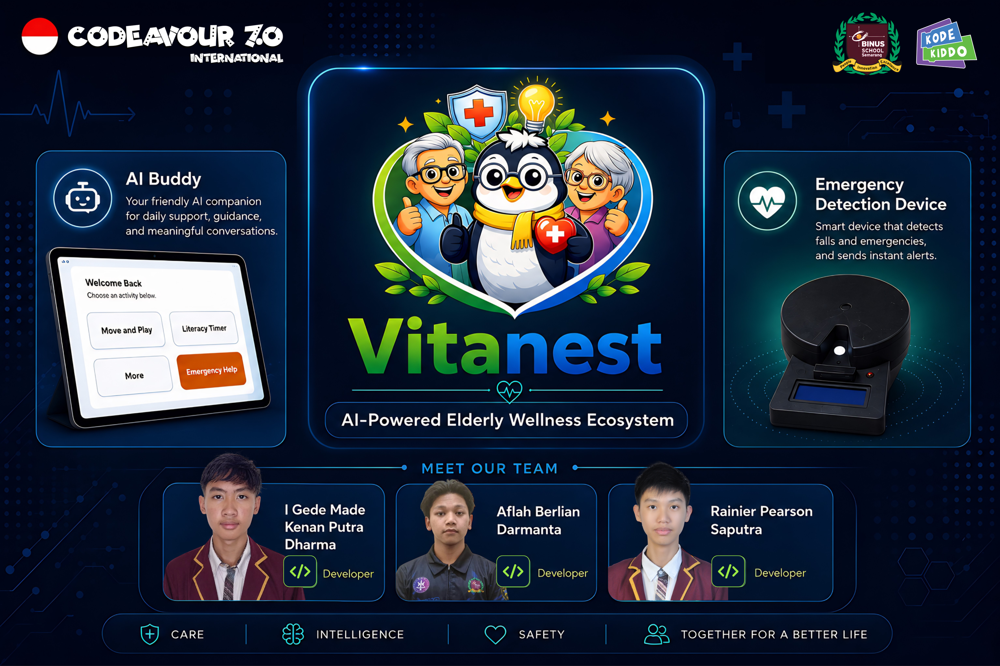
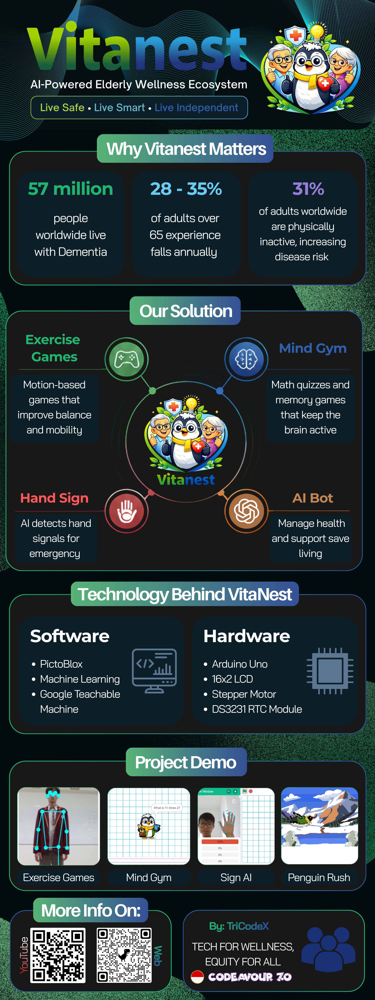

# VITANEST

## About

Vitanest is designed to help elderly individuals stay physically active, mentally sharp, and safe using a simple and accessible technological system. Our mission is to bridge the gap between advanced technology and elderly accessibility by providing a platform that combines artificial intelligence, cognitive training, safety monitoring, and healthcare support in one easy-to-use ecosystem.

This project is created for the Codeavour 7.0 International coding competition.

## Live Demo
- [Project Website](https://rainier-ps.github.io/Vitanest)
- [Pictoblox Download](https://pictoblox.page.link/XcnJDdHkGGdoYRAeA)

## Credits

1. Aflah Berlian Darmanta
2. I Gede Made Kenan Putra Dharma
3. Rainier Pearson Saputra